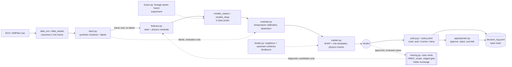

# Architecture

## Data flow

1. **Frame.** Raw meter data become a canonical 1-minute frame (`v i p q s pf e valid_frac` + extras). Gaps stay NaN.
2. **Inject.** `inject()` (v2: edits only real registers, derived channels follow; see `results/leakage_audit.md`) returns the modified frame, a labels frame and a manifest. Labels never reach models or explainers.
3. **Features.** Windows (default 15 min, stride 5) get channel statistics and normalized physics residuals
   (`pf` vs `p/s`, `s` vs `sqrt(p^2+q^2)`, `s` vs `v*i`, `diff(e)` vs `p/60`, frozen-run length, missing fraction).
   Checks that cannot be evaluated are omitted or flagged *unsupported*; they never count as passed.
4. **Models.** The headline detector is the IMPROVE bundle (`models_v2.load_best()`: `features_v2` windows, 3 bagged LightGBM, temperature, validation-tuned alert threshold, segment-level class); it has no `unresolved` output of its own, the policy margin in `explain.decide_label` adds it. Baselines: Each returns `[p_normal, p_measurement, p_physical]` (unsupervised ones via a small head fit on the calibration block).
5. **Calibrate + abstain.** Temperature scaling on the calibration block; below `abstain_below` or with a small top-2 margin the label is `unresolved`.
6. **Explain.** Deterministic template: failed/passed/not-evaluated checks, top SHAP features, alternative explanation, caveats.
7. **Route.** `policy.route(verdict, context)` picks action and authority independently of the model. Mutating actions are human-only;
   high confidence under shift or with single-source evidence is forced to a human.
8. **Log + UI.** Detections, conclusions, decisions and operator actions are appended to the hash-chained log. Approvals are bound to
   an action hash and an evidence version.

## Module map

| File | Role | Status |
|---|---|---|
| `energymind/data_eco.py`, `data_ampds.py`, `scripts/build_data.py` | frames | built |
| `energymind/stub.py` | synthetic clean frame for tests/demo | built |
| `energymind/inject.py` | injector, `split_by_time`, `split_edges` | built |
| `energymind/features.py` | `FeatureBuilder`, `window_features` | built |
| `energymind/features_v2.py` | `FeatureBuilderV2` (causal context: 60/240-min, 7-day baseline, replay, ratios, time of day), train/val data helpers | built (IMPROVE) |
| `energymind/models_v2.py` | event-level metric (`segments`, `event_prf`), `decide` alert rule, `Bundle`, `load_best()` | built (IMPROVE) |
| `scripts/run_improve.py`, `scripts/improve_search.py` | frozen IMPROVE pipeline; diagnosis / search / audit / ablation / compare (`docs/IMPROVEMENT.md`) | built |
| `scripts/demo_end_to_end.py` | best model -> segments -> Verdicts -> policy -> `outputs/incidents.jsonl` (`docs/OPERATOR_UI.md`) | built |
| `energymind/models_classic.py` | `StatBaseline`, `IsoForestModel`, `OCSVMModel`, `LGBMModel` | built |
| `energymind/models_deep.py` | `AEDetector`, `TCNClassifier`, `make_sequences` | built |
| `energymind/evaluate.py` | `event_metrics`, `calibration`, `risk_coverage`, `latency_benchmark`, plots | built |
| `energymind/explain.py` | `explain_verdict`, `shap_for_tree`, `physics_checks_from_row` | built |
| `energymind/policy.py`, `configs/policy.yaml` | `route`, `action_hash`, `validate_approval` | built |
| `energymind/decision_log.py` | `append`, `verify`, `read` | built |
| `energymind/schemas.py` | `Verdict`, `PhysicsCheck` | built |
| `app/operator.py`, `scripts/make_demo_incidents.py` | operator UI (Operator + Evaluation tabs); synthetic fallback demo data | built |
| `energymind/pipeline.py` | `load_split`, `build_windows`, legacy-injector switch | built |
| `energymind/data_wpuq.py`, `scripts/build_wpuq.py` | WPuQ frames (fusion track, indicative) | built |
| `energymind/feeder.py`, `scripts/run_feeder.py` | SimBench feeder, network-evidence diagnostic (`docs/FEEDER.md`) | built (experiment) |
| `energymind/fusion.py`, `scripts/run_fusion.py` | lineage-aware fusion (`docs/FUSION.md`) | built (experiment) |
| `energymind/sharing.py`, `scripts/simulate_two_nodes.py` | case cards, HMAC, scope/review, staged gate, revocation (`docs/SHARED_LEARNING.md`, `SHARING_RESULTS.md`) | built (prototype; gate closed in v2 runs) |
| `scripts/leakage_audit.py` | legacy-vs-v2 shortcut audit (`results/leakage_audit.md`) | built |
| `scripts/run_experiments.py`, `run_deep.py` | classic / deep experiment runners | built |
| k-anonymity export, trust score, PKI, federated learning | | **planned** |
| Neo4j, Qdrant, Postgres ledger, LangGraph, OPA, GNN, GraphRAG, Kafka/MQTT, FastAPI, NILM TCN | OMEGA items; `policy.py` stands in for OPA, hash-chained JSONL for the ledger | **planned** (status table in `docs/PROPOSAL.md` section 6) |

## Design choices that matter

- **Physics-validity flags.** Each residual check is `supported` / `passed`; an unsupported check is shown as such, never as passed.
- **Evidence dependence.** Residuals derived from one meter are correlated, not independent evidence. The over-trust guard counts distinct
  evidence *sources*; `fusion.py` tests lineage-aware fusion: it fixes naive over-confidence but does not beat a refit flat stacker.
- **Electrical vs reporting propagation.** A real sag shows at neighbouring and upstream meters; a faulty reporting chain does not.
  Tested on a SimBench feeder (+4.1 to +7.3 pp event accuracy); not built into the node pipeline.
- **Abstention.** `unresolved` is a legitimate output and routes to a human.
