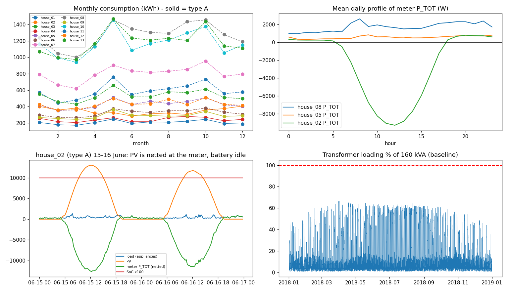
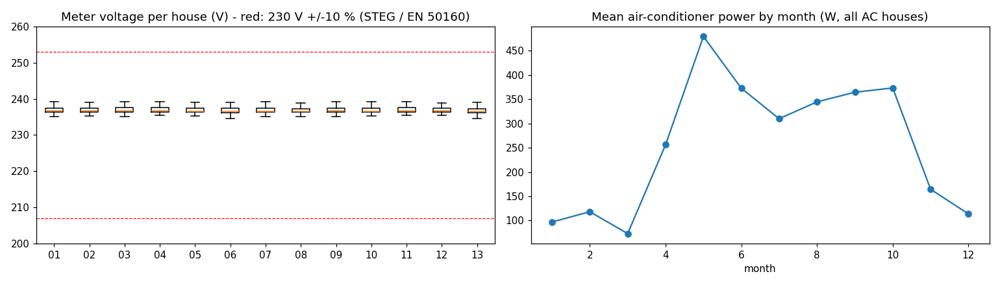

# EnergyMind v3 - Report on the clean data (no anomaly injection)

Source: `clean/_baseline_measured_with_battery/` (measured meter data + simulated battery), `clean/ground_truth/`, `clean/grid_*.csv`, `clean/house_inventory.csv`.

## 1. Important: which folder is really clean

- `clean/measured/` is **not clean**: the earlier `scripts/anomalies/inject_anomalies.py` wrote its anomalies there (NaN dropouts, zero-voltage outages, transformer loading up to 131 %). Houses affected: 13/13.
- The true anomaly-free copy is `clean/_baseline_measured_with_battery/`: **0 missing values, 0 duplicated timestamps, no zero voltage**, 35,040 rows per house (2018-01-01 00:00 to 2018-12-31 23:45, 15 min, no gap).
- All v3 work starts from this folder.

## 2. Dataset structure

- 13 houses on the SimBench rural LV network LV1.101 (one 160 kVA 20/0.4 kV transformer, 13 cables NAYY 4x150, 4 feeders).
- Feeders (from the transformer): `h08` | `h12 > h05 > h04` | `h09 > h10 > h03 > h06 > h13` | `h02 > h11 > h01 > h07`.
- Meter: 22 channels (U, I, P, Q, S, PF per phase + P/Q/S/PF totals). Appliance sub-metering: 8-13 `app_*_W` columns per house.
- Type A (h02, h04, h09, h11) add PV (`P_PV_W`, `E_PV_kWh`) and 14 battery/inverter columns.

## 3. Per-house statistics

| house | type | load kWh/day | peak W | load factor | P_TOT min W | U mean V | U min-max V | unbalance % | PF | appliances |
|---|---|---|---|---|---|---|---|---|---|---|
| house_01 | B (grid only) | 19.4 | 7,591 | 0.11 | 173 | 237.0 | 234.6-240.2 | 0.22 | 0.971 | 10 |
| house_02 | A (PV+battery) | 11.3 | 4,108 | 0.11 | -13,803 | 236.9 | 234.9-239.8 | 0.22 | 0.963 | 12 |
| house_03 | B (grid only) | 17.6 | 5,684 | 0.13 | 170 | 237.0 | 234.2-240.3 | 0.25 | 0.975 | 10 |
| house_04 | A (PV+battery) | 7.9 | 3,954 | 0.08 | -16,759 | 237.1 | 234.8-240.2 | 0.23 | 0.971 | 13 |
| house_05 | B (grid only) | 14.1 | 3,883 | 0.15 | 128 | 236.9 | 234.5-239.9 | 0.25 | 0.965 | 11 |
| house_06 | B (grid only) | 10.6 | 3,454 | 0.13 | 88 | 236.8 | 234.1-240.1 | 0.27 | 0.971 | 12 |
| house_07 | B (grid only) | 26.3 | 9,041 | 0.12 | 243 | 236.9 | 234.3-240.2 | 0.31 | 0.971 | 9 |
| house_08 | B (grid only) | 41.6 | 13,736 | 0.13 | 373 | 236.8 | 234.1-239.9 | 0.34 | 0.976 | 8 |
| house_09 | A (PV+battery) | 9.4 | 3,239 | 0.12 | -28,878 | 237.0 | 234.7-240.5 | 0.27 | 0.973 | 11 |
| house_10 | B (grid only) | 38.5 | 11,699 | 0.14 | 231 | 237.0 | 234.5-240.1 | 0.22 | 0.974 | 11 |
| house_11 | A (PV+battery) | 6.7 | 2,237 | 0.13 | -56,692 | 237.0 | 234.9-240.3 | 0.22 | 0.984 | 9 |
| house_12 | B (grid only) | 14.1 | 4,294 | 0.14 | 126 | 236.9 | 234.9-239.7 | 0.22 | 0.976 | 13 |
| house_13 | B (grid only) | 39.1 | 14,408 | 0.11 | 317 | 236.8 | 232.4-240.3 | 0.30 | 0.969 | 11 |

- Total consumption of the 13 houses: 93.7 MWh/year. Three large consumers (h08, h10, h13: ~40 kWh/day) dominate the feeder; the others use 7-26 kWh/day.
- Voltages stay between 232.4 V and 240.5 V, i.e. well inside 230 V +/-10 % (STEG / EN 50160 band 207-253 V). The network is lightly loaded: the clean data contain **no** voltage problem.
- Meter accuracy (measured vs ground truth): voltage noise ~0.32 V, active power noise ~0.52 % - a class-0.5/1 meter. Useful for the injection: any fault smaller than this is invisible.
- Air conditioning is present in 12/13 houses; its monthly mean peaks in month 5 (see figure). The Tunisian summer scenarios act on this load.

## 4. Network (transformer and voltages)

- Transformer loading: mean 16.2 %, p99 60.3 %, max 66.6 %. Never above 100 %. Hours above 80 %: 0.
- Reverse power flow (PV export to MV): 42.7 % of the time - caused by the netted, oversized PV of type A houses.
- MV voltage is a constant 1.025 pu (no upstream variation in the source simulation); LV bus voltages 1.0158-1.0358 pu.
- There is no transformer voltage among the measured columns (only in `grid_bus_voltage_pu.csv`).

## 5. Type A houses (PV + battery)

| house | PV kWp (inventory) | PV kWh/yr | yield kWh/kWp | PV / load | % time exporting | battery standby % | battery discharge kWh/yr |
|---|---|---|---|---|---|---|---|
| house_02 | 19.0 | 26,971 | 1,420 | 6.5x | 46.6 | 100.0 | 0.0 |
| house_04 | 23.0 | 32,860 | 1,429 | 11.4x | 47.9 | 100.0 | 0.0 |
| house_09 | 40.0 | 56,087 | 1,402 | 16.3x | 48.1 | 100.0 | 0.0 |
| house_11 | 78.4 | 109,648 | 1,399 | 44.5x | 48.9 | 100.0 | 0.0 |

**Findings that block a faithful injection (all three are fixed in v3, step 01):**

1. **The solar-first rule is not in the data.** The meter nets PV: `P_TOT = load - PV` (max 889 W from meter noise on large flows), so type A houses *export* up to 56.7 kW. The battery is idle all year (standby 100.0 % of the time, SoC stuck at 100 %, 0 kWh discharged). The PDF requires: PV and battery supply the load, the grid only when the battery is empty.
2. **PV systems are oversized for a house** (02: 19 kWp, 04: 23 kWp, 09: 40 kWp, 11: 78.381 kWp) - 6.5 to 44.5 times the yearly consumption. These are SimBench generator sizes, not Tunisian rooftop systems (Prosol Elec residential: typically 1.5-6 kWp).
3. PV yield is 1,412 kWh/kWp/yr - plausible for Tunisia (PVGIS Tunis ~1,500-1,700) - so the *shape* of the PV profile is kept and only the size is changed.

## 6. Other limits of the base data

- Load profiles come from the German WPuQ dataset (SFH ids) with an added air-conditioner channel; the energy level of the three large houses (~14 MWh/yr) is above a typical Tunisian household (STEG residential ~1.5-3 MWh/yr).
- Phase voltages differ only by meter noise (the source power flow is balanced); voltage unbalance is 0.22-0.34 %.
- No temperature, irradiance or weather column: shading must be detected from PV vs a clear-sky envelope and the neighbouring PV houses.

## 7. Figures

