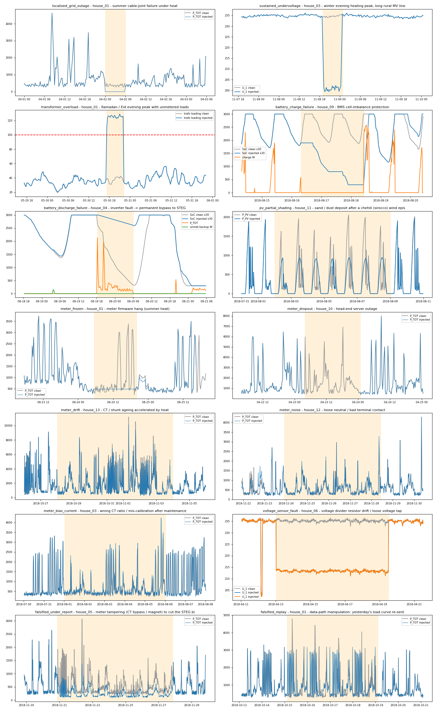

# EnergyMind v3 - Anomaly injection: catalogue and validation

- 492 events, 103,487 anomalous house-steps out of 455,520 (22.72 %), 3,635 house-steps with 2 anomalies at once.
- Labels are set only where the anomaly is observable (type A current faults only while the house imports > 150 W; charge failure only while PV surplus is available; shading only where the measured PV actually changes). The raw fault windows are kept in `active.parquet`.
- The year is cut into 26 blocks of 14 days; test blocks 3, 9, 16, 22 and validation blocks 6, 12, 19, 24 (one per season each). Every event lies fully inside one block.

## Events and labeled steps per label

| label | PDF anomaly / mode | category | house type | events train/val/test | labeled steps train / val / test |
|---|---|---|---|---|---|
| localized_grid_outage | localized_grid_outage  | real_grid_event | A+B | 38/10/10 | 470 / 230 / 215 |
| sustained_undervoltage | sustained_undervoltage  | real_grid_event | A+B | 18/4/4 | 3,315 / 767 / 715 |
| transformer_overload | transformer_overload  | real_grid_event | A+B | 18/4/4 | 2,704 / 780 / 338 |
| battery_charge_failure | battery_failure mode 1 (charge) | real_equipment_event | A | 22/5/5 | 1,107 / 268 / 308 |
| battery_discharge_failure | battery_failure mode 2 (discharge) | real_equipment_event | A | 14/8/8 | 151 / 152 / 146 |
| pv_partial_shading | pv_partial_shading  | real_equipment_event | A | 22/5/5 | 3,101 / 543 / 478 |
| meter_frozen | meter_freeze_or_data_loss mode 1 (frozen) | sensor_problem | A+B | 30/7/7 | 763 / 123 / 142 |
| meter_dropout | meter_freeze_or_data_loss mode 2 (dropout) | sensor_problem | A+B | 30/7/7 | 621 / 205 / 151 |
| meter_drift | sensor_degradation mode 1 (drift) | sensor_problem | A+B | 22/4/4 | 10,838 / 1,775 / 1,744 |
| meter_noise | sensor_degradation mode 2 (noise) | sensor_problem | A+B | 24/5/5 | 7,782 / 1,486 / 1,481 |
| meter_bias_current | sensor_gain_bias mode 1 (current) | sensor_problem | A+B | 24/5/5 | 12,907 / 3,402 / 3,666 |
| voltage_sensor_fault | sensor_gain_bias mode 2 (voltage) | sensor_problem | A+B | 24/5/5 | 11,610 / 3,206 / 2,538 |
| falsified_under_report | meter_falsified mode 1 (under-report) | data_manipulation | A+B | 24/5/5 | 13,655 / 2,584 / 2,303 |
| falsified_replay | meter_falsified mode 2 (replay) | data_manipulation | A+B | 24/5/5 | 6,240 / 1,056 / 1,056 |

## Validation checks (physics and Table B)

| label | checks | passed |
|---|---|---|
| _global | 1 | 1 |
| sustained_undervoltage | 78 | 77 |
| transformer_overload | 78 | 78 |
| localized_grid_outage | 272 | 272 |
| battery_discharge_failure | 60 | 60 |
| battery_charge_failure | 54 | 51 |
| pv_partial_shading | 32 | 32 |
| meter_frozen | 44 | 44 |
| meter_dropout | 44 | 44 |
| meter_drift | 58 | 58 |
| meter_noise | 34 | 34 |
| meter_bias_current | 68 | 68 |
| voltage_sensor_fault | 68 | 68 |
| falsified_under_report | 68 | 68 |
| falsified_replay | 34 | 34 |

Failed checks (sample):

```
{
 "sustained_undervoltage": [
  {
   "check": "feeder end deeper than transformer (U_trafo > U_min house)",
   "pass": false,
   "value": 0.864
  }
 ],
 "battery_charge_failure": [
  {
   "check": "charged energy vs clean run while PV surplus (reduced mode)",
   "pass": false,
   "value": 0.624
  },
  {
   "check": "charged energy vs clean run while PV surplus (reduced mode)",
   "pass": false,
   "value": 0.741
  },
  {
   "check": "charged energy vs clean run while PV surplus (reduced mode)",
   "pass": false,
   "value": 0.764
  }
 ]
}
```

## Most frequent label pairs (two anomalies at once)

| pair | house-steps |
|---|---|
| voltage_sensor_fault|falsified_under_report | 887 |
| meter_noise|voltage_sensor_fault | 555 |
| meter_drift|voltage_sensor_fault | 235 |
| transformer_overload|meter_bias_current | 184 |
| meter_bias_current|voltage_sensor_fault | 177 |
| sustained_undervoltage|meter_bias_current | 160 |
| sustained_undervoltage|meter_drift | 124 |
| sustained_undervoltage|falsified_under_report | 116 |
| transformer_overload|falsified_under_report | 104 |
| transformer_overload|meter_noise | 98 |
| sustained_undervoltage|falsified_replay | 95 |
| pv_partial_shading|voltage_sensor_fault | 93 |
| localized_grid_outage|battery_discharge_failure | 91 |
| pv_partial_shading|meter_noise | 87 |
| transformer_overload|voltage_sensor_fault | 80 |

## Tunisian causes used

| label | causes |
|---|---|
| localized_grid_outage | LV fuse blown at the evening peak; storm / wind damage on the LV cable; summer cable-joint failure under heat; third-party works damaged the cable |
| sustained_undervoltage | MV feeder overloaded at the evening peak (summer AC); Ramadan iftar evening peak on the MV feeder; upstream HV/MV substation tap limit reached; winter evening heating peak, long rural MV line |
| transformer_overload | Ramadan / Eid evening peak with unmetered loads; heat wave: unmetered AC demand of other customers; illegal (unmetered) connections in summer |
| battery_charge_failure | BMS cell-imbalance protection; BMS over-temperature charge block (battery room > 45 C); MPPT charge-controller fault |
| battery_discharge_failure | BMS discharge protection stuck; BMS discharge protection stuck (cell over-temperature); BMS-inverter CAN communication lost; BMS-inverter communication lost; inverter IGBT / DC-link fault; inverter fault -> permanent bypass to STEG |
| pv_partial_shading | laundry / object placed on the panels; neighbour added a floor (shadow); sand / dust deposit after a chehili (sirocco) wind episode; shadow of a roof water tank / satellite dish |
| meter_frozen | concentrator keeps re-sending the last frame; meter firmware hang (summer heat) |
| meter_dropout | GPRS / 3G coverage loss (rural area); PLC communication loss; head-end server outage |
| meter_drift | CT / shunt ageing accelerated by heat |
| meter_noise | ADC degradation; EMI from a nearby inverter or pump; loose neutral / bad terminal contact |
| meter_bias_current | wrong CT ratio / mis-calibration after maintenance |
| voltage_sensor_fault | voltage divider resistor drift / loose voltage tap |
| falsified_under_report | meter tampering (CT bypass / magnet) to cut the STEG bill |
| falsified_replay | data-path manipulation: yesterday's load curve re-sent |


